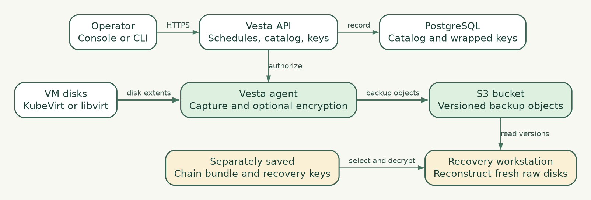

# How a VM backup becomes a recovery point

Vesta runs beside your virtualization platform. The console or CLI asks the API for a backup. The agent reads the VM disks and sends the selected data to your S3-compatible bucket. The disk data travels directly from the agent to storage. The API records which objects, disk identities, keys and parent backup belong together in PostgreSQL.

## What gets copied

| Source | First full | Subsequent incremental |
| --- | --- | --- |
| OpenShift Virtualization or OKD with the supported KubeVirt backup APIs | The agent uses a VM backup, tracker and export to read the selected disk extents. The instance must be running and Ready on a node, and report changed-block tracking (CBT) enabled, including for the full. | KubeVirt supplies changed extents relative to an accepted checkpoint. The agent uploads the selected disk changes and records their parent. Scratch sizing includes **all** native persistent VM disks, even disks excluded from the upload. |
| Native libvirt on the supported EL9 host profile | The host agent uses the libvirt backup API to create a full capture of selected qcow2 disks and a checkpoint. Allow space on the host for staging before upload. | The agent requires the exact accepted libvirt checkpoint and matching disk identities. A missing checkpoint calls for a new full baseline after the affected chain is reviewed. |

Choose a fixed full or incremental policy, or give an automatic schedule a maximum chain length and a full-backup interval. Automatic scheduling can start a new full when it establishes that a usable parent is absent. An explicit incremental requires a usable parent. Keep the full and each preceding incremental for every point you intend to recover. [Daily operations](../okd/runbooks/operations.md)

Sparse extents and changed-block tracking can reduce bytes sent. A change to a busy database disk can cover much of that disk between backups. Plan storage from the actual bytes your workload writes. Vesta publishes no general-purpose compression or cross-VM deduplication ratio. [Sizing and recovery time](sizing-and-recovery-time.md)

## What consistency means for a database

Plan for **crash recovery** unless you have checked application-level consistency. A VM checkpoint identifies a disk point. A CSI volume group snapshot can capture several volumes at the same instant when the whole stack supports it. A database may still have data in memory, and an application may coordinate state across several VMs.

For a database with its own backup protocol, take its supported backup or coordinate its documented quiesce and log sequence around the disk capture. Restore into an isolated network, start the database and test a known transaction. A successful disk verification answers a different question from a successful application recovery. [First recovery](../../docs/first-recovery.md) · [Storage compatibility](storage-compatibility.md)

## Protecting the backup in S3

With client-side encryption enabled, each backup attempt gets a cryptographically random 256-bit data encryption key. The agent encrypts payload chunks with AES-256-GCM before upload. The site wraps the data key with a local key-encryption key and keeps the wrapped material in the catalog. The installation secret protects the local key material stored in PostgreSQL. The password on a recovery export protects that export with a salted PBKDF2-HMAC-SHA-256 derived key. Rotating keys means keeping earlier keys for retained chains.

Keep the database, installation secret, recovery export and its password under separate recovery custody. For independent disk recovery also save a trusted chain bundle and the per-backup data keys it needs, with restricted access. A bucket containing encrypted VM objects alone is insufficient. [Set up S3 and keys](../okd/runbooks/first-configuration.md) · [Security and reporting](../../SECURITY.md)

## Choose the recovery you need

| Goal | Recovery path |
| --- | --- |
| Bring a KubeVirt VM back | Restore into new PVCs and a fresh VM in an allowed namespace. Review the disks and NICs before booting the halted VM. A disk omitted from the backup stays omitted from the restored definition. |
| Bring a native VM back | Use the compatible native host recovery workflow with fresh disk paths and a new domain identity. Review networking before the first boot. |
| Get raw disks while the Vesta API or hypervisor is unavailable | Use the standalone release binary `vesta-restore` on a trusted workstation with your saved chain bundle, S3 read access and the required keys. Native chains also use the native image tools listed in the restore manual. |
| Retrieve one file | Recover the disk or boot a fresh VM in isolation, then copy the file from the restored filesystem. The current product has no indexed file browser or backup-time guest file catalog. |
| Move between clusters or hypervisor families | Treat a different cluster as a separate target that needs capacity, compatible volumes, credentials and network mapping. Raw-disk recovery provides an input for manual migration. Automated libvirt-to-OpenShift conversion and generic cross-cluster failover are outside the qualified restore paths. |

When the control plane is down, scheduling, new backup coordination and catalog export need it back. A workstation with the saved recovery material can still reconstruct disks directly from S3. A license renewal is never a prerequisite for reading a recovery point. [Fresh VM and offline disk restore](../okd/runbooks/restore.md) · [Recover during an incident](recovery-incidents.md)
